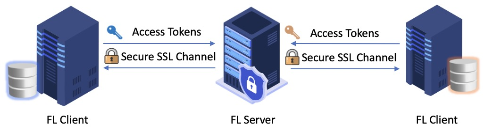

Run FL over secure RPC
======================

In this part, we describe how to run a federated learning experiment with authentication using an FL server and an FL client. The following figure illustrates gRPC communication with a token-based authenticator:

As access tokens are transferred from the clients to the server for authentication, a secure SSL channel is required for gRPC communication to encrypt the transmitted data. In each RPC from a client to the server, the client attaches its authentication token as call metadata, which the server validates. APPFL currently supports two types of authenticators: ``NaiveAuthenticator`` for demonstration purposes and ``GlobusAuthenticator`` for real deployments. Please refer to the `authenticator documentation <https://github.com/APPFL/APPFL/tree/main/src/appfl/login_manager>`_ to learn more about the authenticators and how to define your own authenticator if needed.

In the following two notebooks, we use the ``NaiveAuthenticator`` for easy demonstration, where the client simply uses a hardcoded authentication token for validation.

.. toctree::
    :maxdepth: 1

    launch_server_auth.ipynb
    launch_client_auth.ipynb
