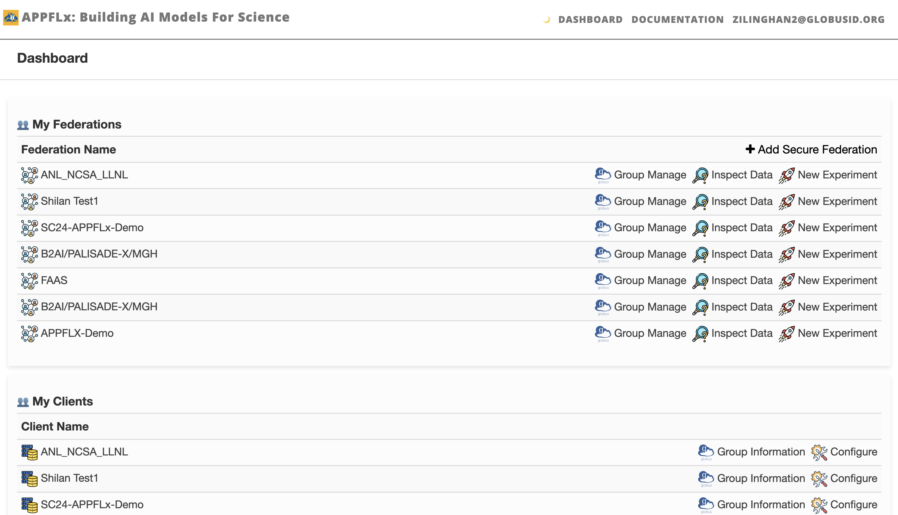

Create Federation
=================

This page describes how to create a federated learning group (federation) and invite collaborators.

1. Log in to the `web application <https://appflx.link>`_ by following the instructions.

2. You will be directed to a dashboard page after signing in. The dashboard lists your **Federations** and your **Clients**. Specifically, **Federations** are the FL groups that you created, i.e., groups in which you are the leader who can start FL experiments and access the experiment results. **Clients** are the FL groups of which you are a member. By default, the federation leader is also a client of their own federation.

3. To create a federation, click the **+ Add Secure Federation** button on the dashboard, follow the instructions in **Create Globus Group** to create a Globus group for federated learning, and then copy the group UUID into **Group ID**.

4. Click **Save**, and you will see your newly created group on the dashboard.

5. To invite collaborators to join the federation, go to the dashboard page and click the **Group Manage** button next to your federation, which opens the Globus group management page. Click the **Members** tab at the top, and then click **Invite Others to Join** at the top right. Then you can invite your collaborators by typing their name or email address.
