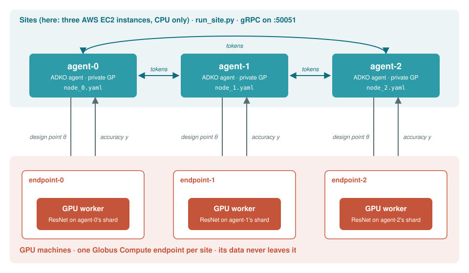
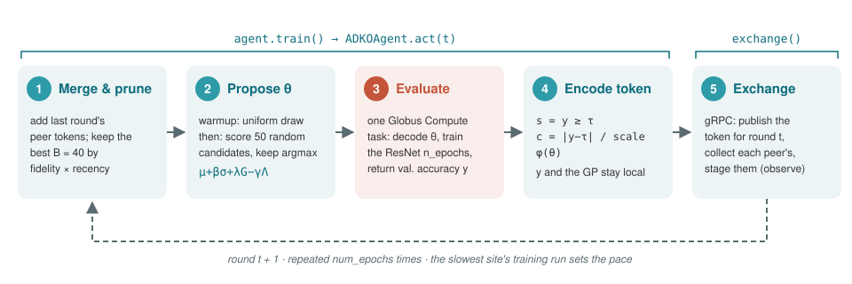
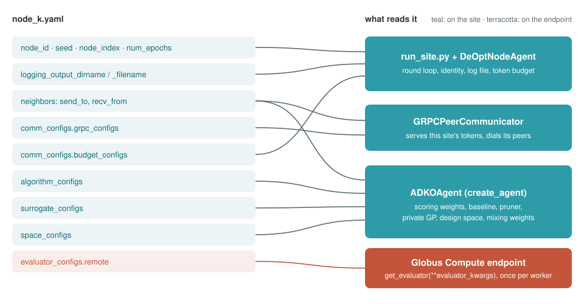

Example: Decentralized Architecture Search with ADKO, gRPC and Globus Compute
=============================================================================

This tutorial runs a decentralized optimization experiment across machines. Three agents work together to search for a good ResNet design for CIFAR-10. Each agent trains candidate networks only on its own share of the data. After each round, an agent shares one short **knowledge token** with its peers. A token says, roughly, "this region of the design space worked, or failed, this decisively". The agents never send models, data or raw accuracies.

The experiment shows a deployment pattern that also fits your own applications:

- the **agents** run at the sites, on cheap CPU machines. Here they are three AWS EC2 instances, and they talk to each other directly over gRPC;
- each **expensive evaluation**, here training a ResNet, is sent as a task to a GPU machine through `Globus Compute <https://globus-compute.readthedocs.io>`_. In general, each site has **its own endpoint**, on a machine it controls, and its data stays there. To keep this example easy to set up, all three sites share **one** endpoint on ALCF Polaris. The only change needed for one endpoint per site is a different ``endpoint_id`` in each site's config.

   The deployment. Agents and the token exchange run on the sites, and each site sends its training runs as Globus Compute tasks to its own endpoint. Only a design point and an accuracy pass between a site and its endpoint. In this example, the three endpoints are a single Polaris endpoint shared by all three sites.

The tutorial has three parts. :ref:`What the experiment does <adko-cifar10-experiment>` explains the experiment. :ref:`The configuration <adko-cifar10-config>` goes through every block of a site's configuration file. The remaining sections set up the endpoint and the sites, then run the experiment. The last section, :ref:`adapting it <adko-cifar10-adapting>`, shows which three files to replace to run your own optimization problem on the same setup.

.. grid:: 2
    :gutter: 2

    .. grid-item-card:: What you need

        - three machines that can reach each other on one TCP port (50051 here);
        - a GPU machine where you can run a Globus Compute endpoint;
        - a Globus account, the same one on every site;
        - APPFL installed from source on all of them.

    .. grid-item-card:: Where the code lives

        - launcher: ``examples/decentralized/grpc/run_site.py``
        - configs: ``examples/decentralized/resources/configs/cifar10/globus_compute/``
        - experiment files: ``examples/decentralized/resources/{space,surrogate,evaluator}/``
        - algorithm: ``src/appfl/decentralized/algorithm/adko/``

.. _adko-cifar10-experiment:

What the experiment does
------------------------

The design space
~~~~~~~~~~~~~~~~

A design point is a vector :math:`\theta \in [0, 1]^7`. ``cifar10_nas_space.py`` decodes it into a CIFAR-adapted ResNet and the recipe used to train it:

.. list-table::
   :header-rows: 1
   :widths: 10 25 65

   * - dim
     - meaning
     - decoded value
   * - 0
     - base width
     - one of {8, 16, 32, 64} channels; the three ResNet groups use w, 2w and 4w
   * - 1
     - blocks per group
     - one of {2, 3, 5}, which sets the depth
   * - 2
     - learning rate
     - :math:`10^{-4 + 3t}`, from 1e-4 to 1e-1 (Adam)
   * - 3
     - weight decay
     - :math:`10^{-5 + 3t}`, from 1e-5 to 1e-2
   * - 4
     - dropout
     - :math:`0.5\,t`, from 0 to 0.5, before the classifier
   * - 5
     - batch size
     - one of {32, 64, 128, 256}
   * - 6
     - schedule
     - cosine annealing if :math:`t > 0.5`, otherwise a constant learning rate

All agents search the **same** space. What differs between them is their **data**. Each agent has a private shard of 10,000 CIFAR-10 training images, split 8,000 for training and 2,000 for validation. Evaluating a point means training that network from scratch on the agent's 8,000 images and returning its accuracy on the 2,000 validation images. Evaluation is the expensive part, which is why it runs on a GPU endpoint.

The configs in this tutorial use the **IID** split, where every agent draws an independent uniform sample. The non-IID split gives each agent its own block of classes, so it needs a number of agents that divides 10 evenly, such as 2 or 5. Three does not, so this setup uses IID.

One round
~~~~~~~~~

Each site runs the same loop for ``num_epochs`` rounds. In the decentralized setting, ``num_epochs`` is the number of **rounds**, not training epochs. The training epochs per evaluation are set separately, in ``n_epochs``.

   One round on one site. Steps 1--4 are ``ADKOAgent.act``, called through APPFL's ``agent.train()``; step 5 is the gRPC exchange. Only step 3 leaves the site, and only the token leaves in step 5.

1. **Merge and prune.** The tokens collected from peers in the previous round join the agent's token memory. If the memory holds more than :math:`B` tokens (``token_budget``), the agent keeps the :math:`B` tokens with the highest score :math:`\hat\eta_k \, c_k \, e^{-\alpha_\tau (t - t_k)}`. That score combines how informative a token is, how decisive it is, and how recent it is.
2. **Propose.** For the first ``warmup_rounds`` rounds, the agent picks a point uniformly at random, because a GP fitted to almost no data cannot guide the search yet. After warmup, the agent draws ``n_local_candidates`` random candidates and picks the one with the highest score:

   .. math::

      \text{score}(\theta) = \mu(\theta) + \beta\,\sigma(\theta) + \lambda\,G(\theta) - \gamma\,\Lambda(\theta)

   :math:`\mu` and :math:`\sigma` come from the agent's **private** Gaussian process surrogate, which is fitted only to its own measurements. :math:`G` and :math:`\Lambda` come from the **peers' tokens**. :math:`G` pulls the agent toward regions where peers reported success, and :math:`\Lambda` pushes it away from regions where they reported failure. Each token's pull is weighted by how close it is to the candidate, :math:`\exp(-d^2/\sigma_s^2)`, and by how decisive it is.
3. **Evaluate.** The point is sent to the Globus Compute endpoint. There the worker decodes it, trains the ResNet for ``n_epochs`` epochs on this agent's shard, and returns the validation accuracy :math:`y`. This is the only step that leaves the site.
4. **Encode.** The agent turns the result into a token :math:`k = \{s, c, \varphi(\theta)\}`, using a fixed baseline :math:`\tau` (``threshold``):

   - :math:`s` = SUCCESS if :math:`y \ge \tau`, FAIL otherwise;
   - :math:`c = \min(1, |y - \tau| / \text{scale})` is how decisive the result is;
   - :math:`\varphi(\theta)` is where in the space it was measured. In this example, :math:`\varphi` is the identity.

   The accuracy :math:`y` itself is used to update the private GP and is never sent.
5. **Exchange.** The site publishes its token for round :math:`t` and collects each peer's token for the same round. The collected tokens are staged and merged at the start of the next round.

What crosses the network
~~~~~~~~~~~~~~~~~~~~~~~~

.. list-table::
   :header-rows: 1
   :widths: 30 35 35

   * -
     - is sent
     - never leaves its owner
   * - between sites (gRPC)
     - one token per peer per round: a signal, a confidence and a 7-number location
     - the accuracy, the GP, the measurement history and the data
   * - site to endpoint (Globus Compute)
     - the design point, the evaluator's path and keyword arguments, and the evaluation index
     - the token memory and the other agents' results
   * - endpoint to site
     - one float, plus the seconds spent training
     - the data shard and the trained network, which is discarded

Each site meters what it sends, and the run report prints the totals: tokens emitted and bits sent.

.. _adko-cifar10-config:

The configuration
-----------------

Each site has **one complete config file**. Centralized FL splits configuration between a server and its clients, but a decentralized federation has no server. So each site's file describes everything that site needs: who it talks to, what it optimizes, and where its evaluations run. The three files are identical except for the site's identity, its neighbors and the agent index.

   Each block of ``node_k.yaml`` and the component that reads it. Everything is read on the site except ``evaluator_configs.remote``, whose evaluator is built on the endpoint.

Here is ``node_0.yaml`` in full, with the machine-specific values replaced by placeholders and the run length set to the reference study's 30 rounds × 40 epochs. The copy in the repository is set to 10 × 10 so that a run fits in a one-hour queue, and its addresses and paths come from one real run.

.. code-block:: yaml
    :linenos:

    node_id: "agent-0"
    seed: 42
    node_index: 0                   # this site's position; sets its RNG seed offset
    num_epochs: 30                  # T: rounds, not training epochs
    logging_output_dirname: "./output"   # log file: <dirname>/<filename>_<node_id>_<timestamp>.txt
    logging_output_filename: "result"

    neighbors:
      mode: "explicit"
      send_to: ["agent-1", "agent-2"]
      recv_from:
        - node_id: "agent-1"
          server_uri: "<SITE1_IP>:50051"
        - node_id: "agent-2"
          server_uri: "<SITE2_IP>:50051"

    comm_configs:
      budget_configs:
        bits_per_neighbor_per_round: null
        tokens_per_neighbor_per_round: 1
      grpc_configs:
        server_uri: "0.0.0.0:50051"            # listen on every interface; peers dial this site's public IP
        max_message_size: 1048576
        use_ssl: False

    algorithm_configs:
      warmup_rounds: 3              # n_initial
      token_budget: 40              # B
      alpha_tau: 0.05
      objective: "maximize"
      emit_insight: false
      total_proposals: null
      n_local_candidates: 50        # n_candidates
      weights:
        beta: 2.0
        lam: 2.0
        gamma: 32.0
        sigma_s: 0.5
        metric: "euclidean"
        kernel: "sigma_sq"
        weight_by_fidelity: true
        peer_normalization: "mixing_weight"
      baseline:
        baseline: "fixed"
        baseline_kwargs:
          threshold: 0.7            # tau
          scale: 0.5                # Y_SCALE
      pruner:
        pruner: "fidelity"
        pruner_kwargs:
          alpha_tau: 0.05

    surrogate_configs:
      surrogate_path: "./decentralized/resources/surrogate/matern_gp_surrogate.py"
      surrogate_name: "get_surrogate"
      surrogate_kwargs:
        dim: 7
        alpha: 0.01
        n_restarts: 2

    space_configs:
      space_path: "./decentralized/resources/space/cifar10_nas_space.py"
      space_name: "get_design_space"
      space_kwargs:
        agent_index: 0
        num_agents: 3
        seed: ${seed}

    evaluator_configs:
      remote:
        backend: "globus_compute"
        endpoint_id: "<ENDPOINT_UUID>"
        timeout: 3600                # seconds per evaluation, including a cold endpoint start
        # Paths as the endpoint sees them: its APPFL checkout and a data directory on its machine.
        evaluator_path: "<APPFL_ON_ENDPOINT>/examples/decentralized/resources/evaluator/cifar10_nas.py"
        evaluator_name: "get_evaluator"
        evaluator_kwargs:
          agent_index: ${space_configs.space_kwargs.agent_index}
          num_agents: ${space_configs.space_kwargs.num_agents}
          distribution: "iid"
          data_dir: "<DATA_DIR_ON_ENDPOINT>"
          download: true
          n_epochs: 40              # training epochs per evaluation
          shard_size: 10000
          val_frac: 0.2
          data_seed: ${seed}
          train_seed: ${seed}       # model init, shuffle and dropout of each training run
          device: "auto"            # cuda:(agent_index % visible GPUs) on the endpoint
        # compute_token_env: "APPFL_GC_COMPUTE_TOKEN"
        # openid_token_env: "APPFL_GC_OPENID_TOKEN"

The path keys under ``surrogate_configs`` and ``space_configs`` are relative to the directory the site is launched from, which is ``examples/``. The paths under ``remote`` are paths **on the endpoint's machine**.

Identity, run length and logging
~~~~~~~~~~~~~~~~~~~~~~~~~~~~~~~~

.. list-table::
   :header-rows: 1
   :widths: 28 72

   * - key
     - meaning
   * - ``node_id``
     - The site's name. Peers use it in their ``send_to`` and ``recv_from`` lists, and it labels the site's tokens and log.
   * - ``seed``
     - The experiment seed. It must be the **same on every site**, because the data split is replayed from it and each site keeps only its own shard.
   * - ``node_index``
     - The site's position, 0 to n-1. The agent's RNG is seeded with ``seed + node_index``, so sites explore differently.
   * - ``num_epochs``
     - The number of rounds :math:`T`. The reference study uses 30. Every site must use the same value, because a site that stops early leaves its peers waiting for its token.
   * - ``logging_output_dirname``, ``logging_output_filename``
     - Where the site writes its log: ``<dirname>/<filename>_<node_id>_<timestamp>.txt``. The defaults are ``./output`` and ``result``.

Neighbors and gRPC
~~~~~~~~~~~~~~~~~~

``neighbors.mode: explicit`` means the site lists its own neighbors and how to reach them, and knows nothing else about the federation: no roster and no graph. Here every site lists the other two, which makes the graph fully connected.

- ``send_to`` lists the peers allowed to collect this site's tokens. It works as an access list.
- ``recv_from`` lists the peers this site collects from, with the address to **dial** for each one, ``<public IP>:50051``.
- ``grpc_configs.server_uri`` is the address this site **listens** on. ``0.0.0.0:50051`` means every interface. On a cloud VM, the public IP is not assigned to any local interface, so listening on the public IP itself fails.

The only differences between the three files are in the identity and neighbor fields:

.. tab-set::

    .. tab-item:: node_0.yaml

        .. code-block:: yaml

            node_id: "agent-0"
            node_index: 0
            neighbors:
              mode: "explicit"
              send_to: ["agent-1", "agent-2"]
              recv_from:
                - {node_id: "agent-1", server_uri: "<SITE1_IP>:50051"}
                - {node_id: "agent-2", server_uri: "<SITE2_IP>:50051"}
            space_configs:
              space_kwargs: {agent_index: 0, num_agents: 3, seed: ${seed}}

    .. tab-item:: node_1.yaml

        .. code-block:: yaml

            node_id: "agent-1"
            node_index: 1
            neighbors:
              mode: "explicit"
              send_to: ["agent-0", "agent-2"]
              recv_from:
                - {node_id: "agent-0", server_uri: "<SITE0_IP>:50051"}
                - {node_id: "agent-2", server_uri: "<SITE2_IP>:50051"}
            space_configs:
              space_kwargs: {agent_index: 1, num_agents: 3, seed: ${seed}}

    .. tab-item:: node_2.yaml

        .. code-block:: yaml

            node_id: "agent-2"
            node_index: 2
            neighbors:
              mode: "explicit"
              send_to: ["agent-0", "agent-1"]
              recv_from:
                - {node_id: "agent-0", server_uri: "<SITE0_IP>:50051"}
                - {node_id: "agent-1", server_uri: "<SITE1_IP>:50051"}
            space_configs:
              space_kwargs: {agent_index: 2, num_agents: 3, seed: ${seed}}

Sites can start in any order, even minutes apart. Each site starts serving before it dials its peers, and a connection to a peer that is not up yet waits instead of failing. ``budget_configs.tokens_per_neighbor_per_round: 1`` caps each site at one token per peer per round. The cap is enforced and metered by the node agent, so the traffic totals are the same under every transport. For sites that cannot accept inbound connections, see the relay setup in ``examples/decentralized/README.md``.

The ADKO block
~~~~~~~~~~~~~~

``algorithm_configs`` holds the algorithm's hyperparameters. The values above follow the stored run configs of the ADKO paper's CIFAR-10 study.

.. list-table::
   :header-rows: 1
   :widths: 30 12 58

   * - key
     - value
     - effect
   * - ``warmup_rounds``
     - 3
     - Rounds of uniform random proposals before the GP guides the search.
   * - ``token_budget``
     - 40
     - :math:`B`, the most tokens an agent remembers. Pruning keeps the best :math:`B`.
   * - ``alpha_tau``
     - 0.05
     - Recency decay used in pruning. Larger values forget old tokens faster. The value in ``pruner.pruner_kwargs`` is the one actually used, so keep the two equal.
   * - ``objective``
     - maximize
     - Accuracy is maximized; use ``minimize`` for a loss. This flips the sign convention of the tokens.
   * - ``n_local_candidates``
     - 50
     - Random candidates scored per round after warmup.
   * - ``emit_insight``
     - false
     - Attach a language-model sentence to each token. Off here; the run is LM-free.
   * - ``weights.beta``
     - 2.0
     - :math:`\beta`, the weight on GP uncertainty (exploration).
   * - ``weights.lam``
     - 2.0
     - :math:`\lambda`, how strongly peers' successes attract.
   * - ``weights.gamma``
     - 32.0
     - :math:`\gamma`, how strongly peers' failures repel. It is large because failed architectures are common and cheap to avoid.
   * - ``weights.sigma_s``
     - 0.5
     - Similarity bandwidth in :math:`[0,1]^7`. It sets how far a token's influence reaches.
   * - ``weights.weight_by_fidelity``
     - true
     - Weight each token by :math:`c \cdot \eta(c)` instead of just :math:`c`, so near-baseline tokens count less.
   * - ``weights.peer_normalization``
     - mixing_weight
     - Combine sources with graph weights :math:`1/(|N|+1)`, the agent itself included.
   * - ``baseline``
     - fixed, 0.7 / 0.5
     - :math:`\tau = 0.7`: an accuracy of at least 70% is a success. The scale 0.5 maps :math:`|y - \tau|` to :math:`c`.
   * - ``pruner``
     - fidelity
     - Pruning rule: ``fidelity`` (ADKO Algorithm 2), ``confidence``, ``fifo`` or ``random``.

``surrogate_configs`` loads ``matern_gp_surrogate.py``, a scikit-learn GP with an ARD Matern-5/2 kernel over the 7 dimensions. ``alpha`` is observation jitter, and ``n_restarts`` is the number of restarts of the kernel optimizer. ``space_configs`` loads the design space described above. Each of the two blocks names a Python file and a factory function, and its ``*_kwargs`` are passed to that function.

The remote evaluator
~~~~~~~~~~~~~~~~~~~~

With a ``remote`` block under ``evaluator_configs``, the agent does not build its evaluator locally. Instead, every evaluation becomes a Globus Compute task. On the endpoint, the task imports ``evaluator_path``, calls ``evaluator_name(**evaluator_kwargs)`` **once per worker process**, and caches the result, so the CIFAR-10 shard is loaded once rather than on every evaluation. The agent's call ``evaluator(point, agent_id=..., round_idx=..., eval_idx=...)`` is then forwarded to that cached evaluator.

.. list-table::
   :header-rows: 1
   :widths: 28 72

   * - key
     - meaning
   * - ``backend``
     - ``globus_compute``, the only backend for now.
   * - ``endpoint_id``
     - The endpoint's UUID, as shown by ``globus-compute-endpoint list``. Normally each site names its own endpoint. This example points all three at one shared endpoint so that only one has to be set up.
   * - ``timeout``
     - Seconds to wait for **one** evaluation, including the first one, which waits for the batch scheduler to start a node. The site stops with ``TimeoutError`` if an evaluation runs past it. Errors are never retried or replaced with a substitute value.
   * - ``evaluator_path``
     - The evaluator file **as the endpoint sees it**, inside the endpoint's own APPFL checkout. ``cifar10_nas.py`` imports ``../space/cifar10_nas_space.py`` next to it, so the checkout must be complete.
   * - ``evaluator_name``
     - The factory function in that file. If omitted, the last function defined in the file is used.
   * - ``evaluator_kwargs``
     - Arguments to the factory, sent with every task (see the next table). ``${...}`` interpolations are resolved on the site before sending.
   * - ``compute_token_env``, ``openid_token_env``
     - Optional. Names of environment variables that hold Globus access tokens, so a site can run unattended without writing a token into a file. Without them, the SDK uses its cached ``globus-compute`` login, or a confidential client from ``GLOBUS_COMPUTE_CLIENT_ID`` and ``GLOBUS_COMPUTE_CLIENT_SECRET``.
   * - ``user_endpoint_config``, ``resource_specification``
     - Optional. Template values for a multi-user endpoint, and per-task resources for an MPI endpoint. Neither is used here.

``evaluator_kwargs`` is passed to ``get_evaluator`` in ``cifar10_nas.py``:

.. list-table::
   :header-rows: 1
   :widths: 28 72

   * - key
     - meaning
   * - ``agent_index``, ``num_agents``
     - Which shard this agent owns. Interpolated from ``space_configs`` so they cannot disagree.
   * - ``distribution``
     - ``iid`` or ``non_iid``. ``non_iid`` needs ``num_agents`` to divide 10.
   * - ``data_dir``, ``download``
     - Where CIFAR-10 is on the endpoint. Compute nodes on many HPC systems are offline, so download the data once from a login node (see below).
   * - ``n_epochs``
     - Training epochs per evaluation. The reference uses 40. Lower it for a smoke test or a short queue.
   * - ``shard_size``, ``val_frac``
     - 10,000 images per agent, 20% of them held out for validation.
   * - ``data_seed``, ``train_seed``
     - ``data_seed`` fixes the shards. ``train_seed`` seeds each training run from ``(train_seed, agent_index, eval_idx)``, so an agent's k-th evaluation starts from the same weights and batches whichever worker runs it. Set ``train_seed`` to ``null`` to leave torch unseeded.
   * - ``device``
     - ``auto`` places agent ``i`` on ``cuda:(i mod visible GPUs)``. When each worker sees one GPU, as below, that is ``cuda:0`` in every worker.

.. admonition:: Must be identical on every site
    :class: important

    ``seed``, ``num_epochs``, ``num_agents``, ``distribution``, ``shard_size``, ``val_frac`` and ``data_seed``. Each site replays the same global split and keeps only its own shard, so if any of these differ, the shards overlap or don't line up and the run no longer compares to the reference. Only ``node_id``, ``node_index``, ``neighbors`` and ``agent_index`` should differ, plus ``endpoint_id`` if you give each site its own endpoint.

Setting up the Globus Compute endpoint
--------------------------------------

The endpoint runs the training. The steps below use ALCF Polaris (PBS Pro, 4 × A100 per node) as an example.

.. note::

    This section only shows **how one endpoint was set up on ALCF Polaris**. Scheduler, queue, network interface, launcher and environment setup all differ between machines, so the template below will not work on other systems as written. To set up an endpoint on your own machine, see the `Globus Compute endpoint documentation <https://globus-compute.readthedocs.io/en/stable/endpoints/endpoints.html>`_ and its `example configurations <https://globus-compute.readthedocs.io/en/stable/endpoints/endpoint_examples.html>`_. If you get stuck, contact the APPFL developers and we can help you configure it.

Whatever the machine, the endpoint needs: APPFL and everything your evaluator imports in the workers' Python environment, the data available on the endpoint's filesystem, and a template that starts workers in that environment, not the default ``uv`` one.

1. **A Python environment with APPFL, a CUDA build of torch, and the endpoint.** On Polaris, build a virtual environment on top of the ``conda`` module, so torch comes from the module:

   .. code-block:: bash

       module use /soft/modulefiles
       module load conda
       python -m venv --system-site-packages <VENV>
       source <VENV>/bin/activate

       git clone https://github.com/APPFL/APPFL.git <APPFL_ON_ENDPOINT>
       cd <APPFL_ON_ENDPOINT> && pip install -e .
       pip install "globus-compute-endpoint==<VERSION>"   # match the sites' globus-compute-sdk

   Keep the endpoint's ``globus-compute-endpoint`` version equal to the sites' ``globus-compute-sdk`` version. Use the same Python minor version on both sides if you can, too: the module's Python is 3.12, and Ubuntu 24.04 also ships 3.12. If ``globus-compute-endpoint`` fails at start-up with ``AttributeError: ... GEN_EMAIL``, run ``pip install -U pyopenssl``; the module's pyOpenSSL is too old for the cryptography version pip installs.

2. **The data, downloaded from a login node.** Polaris compute nodes cannot reach the internet.

   .. code-block:: bash

       OPENBLAS_NUM_THREADS=1 python -c "import torchvision; torchvision.datasets.CIFAR10('<DATA_DIR_ON_ENDPOINT>', train=True, download=True)"

   ``OPENBLAS_NUM_THREADS=1`` avoids an OpenBLAS ``pthread_create`` failure caused by the login nodes' per-user thread limit.

3. **Configure the endpoint** with ``globus-compute-endpoint configure polaris-gpu``. This writes ``~/.globus_compute/polaris-gpu/``. Leave ``config.yaml`` as generated, and **replace** ``user_config_template.yaml.j2`` with the template below. The default template builds a fresh ``uv`` environment for each task, and that environment has neither APPFL nor torch.

   .. code-block:: yaml

       idle_heartbeats_soft: 240          # keep the endpoint up while idle between rounds
       idle_heartbeats_hard: 5760

       engine:
         type: GlobusComputeEngine
         max_workers_per_node: 4
         available_accelerators: 4        # one A100 per worker
         job_status_kwargs:
           max_idletime: 3600             # keep an idle PBS job up to an hour, not 120 s

         address:
           type: address_by_interface
           ifname: hsn0

         provider:
           type: PBSProProvider

           launcher:
             type: MpiExecLauncher
             bind_cmd: --cpu-bind
             overrides: --depth=64 --ppn 1

           account: <PROJECT>
           queue: debug                   # 1 h cap; use prod or preemptable for a full run
           cpus_per_node: 32
           select_options: ngpus=4
           scheduler_options: "#PBS -l filesystems=home:grand:eagle"

           worker_init: |
             module use /soft/modulefiles
             module load conda
             source <VENV>/bin/activate
             export TMPDIR=/tmp
             which python mpiexec

           walltime: 01:00:00
           nodes_per_block: 1
           init_blocks: 0
           min_blocks: 0
           max_blocks: 1

   .. dropdown:: Why each setting is there

       - ``max_workers_per_node: 4`` with ``available_accelerators: 4`` starts four worker processes per node and pins one GPU to each. Three agents use three of them, so evaluations from different sites train in parallel.
       - ``max_idletime`` and ``idle_heartbeats_soft`` keep the PBS job and the endpoint alive between rounds. Without them, the node is released after two idle minutes and every round waits in the queue again.
       - ``address_by_interface: hsn0`` makes the workers connect back over Polaris's high-speed network.
       - ``MpiExecLauncher`` with ``--cpu-bind`` and ``--depth=64 --ppn 1`` starts one manager per node with Cray's ``mpiexec``. If ``which mpiexec`` in the job output shows an MPICH ``mpiexec`` from a conda environment instead, it rejects ``--cpu-bind``. In that case, put ``/opt/cray/pals/1.8/bin`` first on ``PATH`` in ``worker_init``.
       - ``source <VENV>/bin/activate`` loads the environment. If you use a conda environment instead, ``conda activate`` fails in a batch job with ``__conda_exe: command not found``. Prepend the environment's ``bin`` to ``PATH`` instead.
       - ``export TMPDIR=/tmp`` is required. Without it, the worker pool fails to start with ``EOFError`` from Python's multiprocessing ``SyncManager``, and the job is reported as ``Job is marked as MISSING``.
       - ``which python mpiexec`` prints both into the job's ``.stdout`` file, so when something fails you can see what actually ran.
       - ``queue`` and ``walltime``: a full run (30 rounds × 40 epochs) does not fit in the ``debug`` queue's hour. An evaluation still running when the walltime ends fails its site, so choose the queue and walltime for the run.

4. **Start it** and note its UUID:

   .. code-block:: bash

       globus-compute-endpoint start polaris-gpu      # the first start prints a login link
       globus-compute-endpoint list                   # the UUID goes into endpoint_id

   The endpoint keeps running after you log out. Its log is ``~/.globus_compute/polaris-gpu/endpoint.log``. Each PBS job's start-up output is in ``~/.globus_compute/polaris-gpu/submit_scripts/*.stdout`` and ``*.stderr``. The endpoint's state is per login node, so run ``globus-compute-endpoint stop polaris-gpu`` on the same login node where you started it. Workers import APPFL once, so after you pull new code, stop the endpoint and start it again.

5. **Smoke-test it from a site** before running the experiment. Use the ``CombinedCode`` serialization strategy, as APPFL does. The SDK's default sends Python bytecode, which fails between Python versions with errors such as ``'int' object is not callable``.

   .. code-block:: python

       from globus_compute_sdk import Client, Executor
       from globus_compute_sdk.serialize import CombinedCode

       def add(a, b):
           return a + b

       client = Client(code_serialization_strategy=CombinedCode())
       with Executor(endpoint_id="<ENDPOINT_UUID>", client=client) as gce:
           print(gce.submit(add, 5, 10).result())     # 15, once a node has started

Setting up the sites
--------------------

Any three machines that can reach each other on port 50051 will work. This section uses AWS EC2. The sites only fit a small GP and exchange tokens, so a small general-purpose instance with no GPU is enough.

1. **Launch one instance** with Ubuntu 24.04.
2. **Open the gRPC port.** In the instance's security group, allow inbound TCP 50051 from the other sites' public IPs as ``/32`` rules, plus SSH from your own IP. A rule that references the security group itself only matches **private** addresses, while the configs dial **public** IPs, so add the IP rules even if all three instances share the group.
3. **Install the environment.** CPU-only torch is enough on a site. Install ``torchvision`` from the same index as ``torch``; a PyPI ``torchvision`` built for a different torch fails at import with ``operator torchvision::nms does not exist``.

   .. code-block:: bash

       sudo apt-get update
       sudo apt-get install -y git tmux python3-venv python3-dev build-essential
       python3 -m venv ~/venvs/appfl && source ~/venvs/appfl/bin/activate
       pip install --upgrade pip
       pip install torch torchvision --index-url https://download.pytorch.org/whl/cpu
       git clone https://github.com/APPFL/APPFL.git ~/APPFL
       cd ~/APPFL && pip install -e .
       pip install "globus-compute-sdk==<VERSION>"    # the endpoint's version
       echo "source ~/venvs/appfl/bin/activate" >> ~/.bashrc

4. **Optionally, save an image** of this instance and launch the other two sites from it.
5. **Log in to Globus Compute on every site**, using the Globus identity that **owns the endpoint**. A single-user endpoint runs only its owner's tasks. The command below logs in on first use and prints the identity:

   .. code-block:: bash

       python -c "from globus_compute_sdk import Client; print(Client().get_auth_client().userinfo()['preferred_username'])"

   Each site needs its own login. ``invalid_grant`` means the code you pasted was wrong, expired or already used, so run the command again. To run without logging in, set ``compute_token_env`` and ``openid_token_env`` in the config.

6. **Edit the three configs.** Set ``recv_from`` to the other sites' public IPs and ``endpoint_id``, ``evaluator_path`` and ``data_dir`` to your endpoint's values. Copy the configs to every site.

Running the experiment
----------------------

Start each site from the ``examples`` directory, preferably inside ``tmux`` so the run survives SSH disconnects:

.. tab-set::

    .. tab-item:: site 0

        .. code-block:: bash

            cd ~/APPFL/examples
            python decentralized/grpc/run_site.py --config ./decentralized/resources/configs/cifar10/globus_compute/node_0.yaml

    .. tab-item:: site 1

        .. code-block:: bash

            cd ~/APPFL/examples
            python decentralized/grpc/run_site.py --config ./decentralized/resources/configs/cifar10/globus_compute/node_1.yaml

    .. tab-item:: site 2

        .. code-block:: bash

            cd ~/APPFL/examples
            python decentralized/grpc/run_site.py --config ./decentralized/resources/configs/cifar10/globus_compute/node_2.yaml

**Smoke test first.** Set ``num_epochs: 5`` and ``n_epochs: 10`` in all three configs, or pass ``--num_rounds 5`` on every site. A smoke run checks the network, the login and the endpoint in minutes. It is not a reproduction of the reference results.

What to expect:

- each site logs that it is serving, connects to both peers and reports ``ready``;
- the first round waits for PBS to start the endpoint's node. Later rounds start right away, as long as the job stays up;
- a round lasts as long as the **slowest** site's training run, because every site waits for its peers' tokens before the next round;
- at the end, each site tells its peers it is finished, waits until they have collected its last token, and prints its summary: its best design point and accuracy, the mean token fidelity :math:`\bar\eta`, the number of tokens emitted, bits sent, evaluations, and ``remote overhead``. ``remote overhead`` is the wall time of remote calls not spent training, such as queueing, transfer and dispatch;
- the full log is in ``<logging_output_dirname>/<logging_output_filename>_<node_id>_<timestamp>.txt``.

.. dropdown:: Troubleshooting

    .. list-table::
       :header-rows: 1
       :widths: 40 60

       * - symptom
         - cause and fix
       * - A site reports *finished* right after *ready*, and its peers wait.
         - The site's first round raised an exception, and the exception is printed only after the peers stop waiting. Press Ctrl-C on that site to see the traceback. The most common causes are a stale config copied to the site and a site logged in as a different Globus identity from the endpoint owner.
       * - ``Job is marked as MISSING`` in the endpoint log
         - The PBS job could not start its workers. The reason is in ``submit_scripts/*.stderr``; check the ``worker_init`` items above.
       * - ``EOFError`` in ``SyncManager``
         - ``export TMPDIR=/tmp`` is missing from ``worker_init``.
       * - ``No module named 'globus_compute_sdk.sdk.login_manager'``
         - Your APPFL checkout is older than the SDK; ``globus-compute-sdk`` 4.20 removed that module. Update APPFL on **both** the sites and the endpoint, then restart the endpoint.
       * - ``TypeError: 'int' object is not callable`` from a hand-written test
         - Bytecode serialization between Python versions. Use ``CombinedCode``, as shown above.
       * - ``TimeoutError`` naming the endpoint
         - An evaluation took longer than ``timeout``. The endpoint may be offline, the queue may be long, or ``n_epochs`` may be too high for the GPU.
       * - A site never connects to a peer.
         - Port 50051 is not open to that site's **public** IP, or the peer's ``recv_from`` has the wrong address.

.. _adko-cifar10-adapting:

Adapting it to your own application
-----------------------------------

The launcher, the transport and the algorithm do not know they are running CIFAR-10. An experiment is defined by the three files that ``space_configs``, ``surrogate_configs`` and ``evaluator_configs`` name. To optimize your own problem, replace those three files and keep everything else.

**The design space** is a ``DesignSpace`` subclass that says what a point is and how to place it in a shared embedding:

.. code-block:: python

    from appfl.decentralized.algorithm.adko import DesignSpace

    class MySpace(DesignSpace):
        space_id = "my_space"

        def embed(self, point):            # -> list[float]; what tokens carry as phi(theta)
            ...

        def sample(self, n, seed=None):    # -> n random points
            ...

        # optional: enumerate() for a finite grid, local_perturbations(around, n)

    def get_design_space(agent_index=0, num_agents=1, seed=0):
        return MySpace(...)

**The surrogate** is a ``Surrogate`` subclass with ``update(embedding, observation)`` and ``posterior(embeddings) -> [(mu, sigma), ...]``. ``matern_gp_surrogate.py`` works for any continuous space: set ``dim`` to your embedding's length.

**The evaluator** is a factory that does the expensive setup once and returns a function that scores one point:

.. code-block:: python

    def get_evaluator(data_dir, agent_index=0, **settings):
        data = load_my_shard(data_dir, agent_index)       # once per endpoint worker

        def evaluate(point, eval_idx):                    # name only the context you need
            return run_my_simulation(point, data, seed=eval_idx)

        return evaluate

The agent calls ``evaluate(point, agent_id=..., round_idx=..., eval_idx=...)``. Your function receives only the keywords it names, or all of them if it takes ``**kwargs``. Seeding from ``eval_idx`` makes the k-th evaluation reproducible whichever worker runs it.

Then adjust the configuration:

- **Point the remote block at your evaluator file on the endpoint**, and put the evaluator's own settings in ``evaluator_kwargs``. The endpoint's environment needs APPFL plus whatever your evaluator imports. Only the path, the kwargs and the point are sent, never code.
- **Set the baseline on your objective's scale.** ``threshold`` defines what counts as a success and ``scale`` defines how decisive a result is. A fixed baseline suits objectives where success has a natural meaning; otherwise use ``baseline: running_median``, which adapts to each agent's own results. Set ``objective: minimize`` for a loss.
- **Retune** ``sigma_s`` **to your embedding's distances.** It should be about the distance over which two points behave similarly. ``n_local_candidates`` and ``warmup_rounds`` scale with the dimension.
- **Grow the federation** by adding sites, each with its own config that lists its neighbors in ``recv_from`` and ``send_to``. Neighbors don't need to be fully connected. Each site's cost is one token per neighbor per round, however large the federation.
- **Use a separate endpoint per site** by setting a different ``endpoint_id`` in each config. Each site's data then stays on its own machine.
- **Run unattended** with ``compute_token_env`` and ``openid_token_env``, or with a confidential client and a multi-user endpoint.

To try the same experiment without any infrastructure, ``examples/decentralized/README.md`` runs it in one process (``serial/run_serial.py``) or under MPI (``mpi/run_mpi.py``) with ``cifar10/simulation/`` configs. Every launcher builds its agents through the same ``create_agent``, so results carry over between them.
