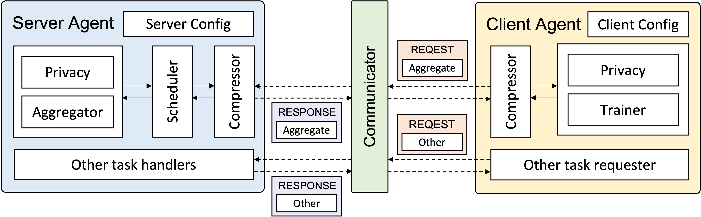

APPFL Components
================

The APPFL framework builds the *server agent* and *client agent* from six main building blocks (Aggregator, Scheduler, Trainer, Privacy, Communicator, and Compressor) to run various FL experiments.

First, let's take a high-level look at the server agent, client agent, and communicator.

.. toctree::
   :maxdepth: 1
   :titlesonly:

   server_agent
   client_agent
   communicator

Now, let's take a look at the building blocks that make up the server agent and client agent in more detail.

.. toctree::
   :maxdepth: 1
   :titlesonly:

   aggregator
   scheduler
   trainer
   privacy
   compressor
